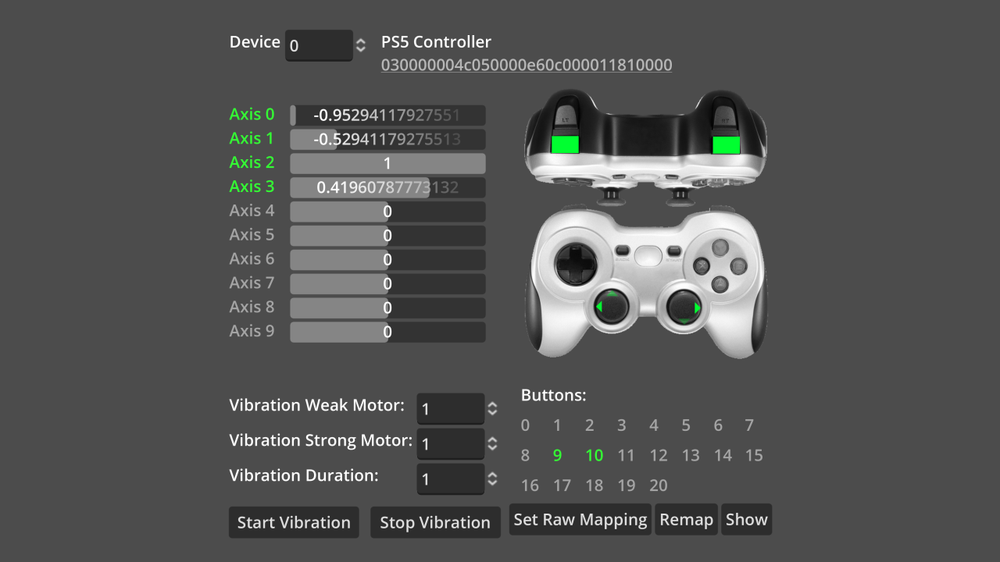
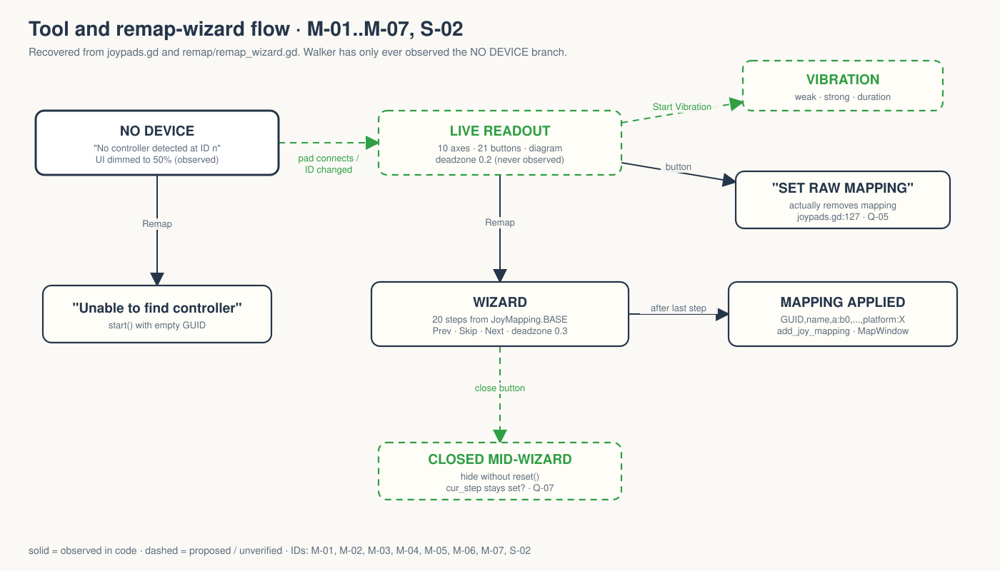

# walker-misc-joypads — Game Design Document (recovered)

| | |
|---|---|
| Version | 0.1.0-recovered |
| Date | 2026-09-27 |
| Author | Zelda (agent, `/gdd reverse --path godot silent`), for Nik Bear Brown |
| Mode | recovered, silent |
| Gate | gate — unsigned at time of writing (vision ○ · systems ○ · world ○ · scope ○) |
| Revision | 1 |
| Source | Godot demo `misc/joypads`, upstream commit `a3b5c113112f77291d5f3d1360f33a882fdc52f7`, local copy in `godot/` |
| Kind | **Input-testing tool and mapping-string generator. Not a game.** |

Provenance tags: `[OBSERVED path:line]` the code does this (paths relative to `godot/`) · `[INFERRED]` implied, evidence stated · `[MISSING]` the code cannot tell you this. Numbers in code are observed values, not approved design. This document describes what exists; it approves nothing.

*`[OBSERVED godot/README.md:15]` screenshot shipped with the upstream Godot demo. Not a Walker capture; Walker ran with no controller connected ("CONNECTED DEVICES []", `../mapping-20260927.log:3`).*

## 1. Vision summary

**What it is.** A single 600×560 window `[OBSERVED project.godot:27-28]` that shows, for one selected device ID, a controller diagram with live button and stick indicators, ten axis bars, a 21-button grid, vibration controls, and a three-step remap wizard that produces an SDL-style controller mapping string `[OBSERVED joypads.gd:31-88, :106-131; remap/remap_wizard.gd]`.

**Stated purpose.** "A tool for testing joypad input." `[OBSERVED project.godot:14]` Upstream README adds "and generating controller mapping strings" `[OBSERVED README.md:3-5]`. The script header says it is a demo "and doubles as a testing application inspired by and similar to jstest-gtk" `[OBSERVED joypads.gd:3-6]`.

**Why it is in Walker.** `[MISSING]` No Walker file states its purpose. `[INFERRED]` from the Walker README: one of a series of adapted Godot demos, headlessly verified and slated for two narrated films; relevant wherever Walker games accept controllers.

**User.** `[INFERRED]` a developer or tester with a controller in hand who needs to see raw indices or build a mapping for an unrecognized pad (GUID links to Godot's game controller database, `joypads.gd:140`).

**Player fantasy, PX goals, win condition.** None. **Ghost Center**, expected for a tool.

**Biggest unresolved question.** Can anything here be verified without a physical controller, and whose controller is it? (Q-06)

## 2. Design pillars

None declared `[MISSING]`. Implicit priorities `[INFERRED]`:

| ID | Implicit priority | Evidence |
|---|---|---|
| IP-01 | Show raw truth, index by index | axes 0-9 and buttons 0-20 listed by number, not by name `[joypads.gd:45-88]` |
| IP-02 | Ignore noise | deadzone 0.2 for display `[joypads.gd:10]`, 0.3 for the wizard `[remap_wizard.gd:4]`; wizard ignores other devices "to handle accidental input and analog drift" `[remap_wizard.gd:32-34]` |
| IP-03 | Make absence obvious | whole UI dims to 50 % alpha and says "No controller detected at ID n" `[joypads.gd:147-152]` |

## 3. Core loop

**Micro (per frame).** Read the spinbox device ID → if it changed, refresh the name/GUID label → read ten axes and 21 buttons → update bars, labels, diagram indicators `[OBSERVED joypads.gd:31-88]`.
**Meso.** Press a button or move a stick → see which index lights up → optionally vibrate → optionally run the remap wizard and copy the resulting string `[OBSERVED]`.
**Macro.** None. Mappings are applied in memory with `Input.add_joy_mapping(..., true)` and never written to disk by the tool `[OBSERVED remap_wizard.gd:91-95]`.

**Loop honesty test.** A diagnostic readout plus a form. No stakes. Judge it as a tool.

## 4. Player Experience Goals

`[MISSING]` None written. Candidates `[INFERRED]`, not approved:

| ID | The user should… | when… | Evidence | Tested by |
|---|---|---|---|---|
| PX-01? | identify any button/axis index in one press | holding a controller | joypads.gd:45-88 | none; no hardware `[MISSING]` |
| PX-02? | produce a working mapping string for an unknown pad | running the wizard | remap_wizard.gd | string format only (T-03..T-12, constructed objects) |
| PX-03? | see immediately that no controller is attached | no pad at the selected ID | joypads.gd:147-152 | T-01, T-02 |

## 5. Mechanics

### M-01 Device selection and identity `[OBSERVED joypads.gd:25-41, :91-103, :138-152]`
Device ID from a SpinBox; name + GUID shown when present (GUID is a clickable link to Godot's `gamecontrollerdb.txt`, opened with `OS.shell_open` `[:134-140]`); otherwise "No controller detected at ID n" and the UI dims. `joy_connection_changed` prints connects/disconnects and refreshes the label if it concerns the current ID. Connected pads are printed at `_ready`.

### M-02 Live axes `[OBSERVED joypads.gd:44-77]`
Axes 0-9 (`min(JOY_AXIS_MAX, 10)`), bar value = 100 × axis. Sticks (axes ≤ `JOY_AXIS_RIGHT_Y`) show a +/− direction indicator beyond deadzone 0.2 with alpha rescaled past the deadzone; triggers show one indicator. Axis labels turn green (`FONT_COLOR_ACTIVE`) beyond the deadzone.

### M-03 Live buttons `[OBSERVED joypads.gd:79-88]`
Buttons 0-20 (`min(JOY_BUTTON_SDL_MAX, 21)`) turn green when pressed; buttons up to `JOY_BUTTON_MISC1` also light on the diagram.

### M-04 Vibration `[OBSERVED joypads.gd:106-114; joypads.tscn:578-641]`
Weak and strong motor 0-1 (default 1.0) and duration 0-10 s (default 1.0) `[tscn:583-617]`; Start calls `Input.start_joy_vibration`, Stop calls `stop_joy_vibration`. Untested `[OBSERVED ../FRICTIONAL.md]`.

### M-05 Remap wizard `[OBSERVED remap/remap_wizard.gd:75-223; remap_wizard.tscn:171-183]`
`start(idx)` fails with "Unable to find controller" if the GUID is empty `[:79-81]`. On Web it first offers two preset mappings (Xbox, Xbox OSX) `[:82-85, :162-167]`; elsewhere it runs the wizard directly. The wizard removes any existing mapping for the GUID `[:151]`, then steps through the 20 keys of `JoyMapping.BASE` (14 buttons + 6 axes) `[joy_mapping.gd:34-58]`, highlighting the target on a diagram. Button press records `bN`; axis motion beyond 0.3 records `aN`, `+aN` or `-aN` with optional `~` inversion, controlled by Full axis / Invert Axis checkboxes `[:36-56, :194-211; joy_mapping.gd:118-132]`. Previous / Skip / Next; after the last step it builds `GUID,name,key:value,...,platform:X`, applies it, and shows it in a text box (on Web via `window.prompt`) `[:59-72, :91-121]`. The subwindow forwards `window_input` to `_input` so pad events arrive while it has focus `[:22-23; tscn:177]`.

### M-06 Clear mapping ("Set Raw Mapping") `[OBSERVED joypads.gd:121-127; joypads.tscn:656-658, :673]`
The button labelled **"Set Raw Mapping"** calls `_on_Clear_pressed`, which **removes** the mapping for the current GUID. `[INFERRED]` the label describes the effect (reverting the pad to raw, unmapped indices) rather than the action; a new user may expect it to *set* something. Logged as Q-05.

### M-07 Show last mapping `[OBSERVED joypads.gd:130-131; remap_wizard.gd:116-121]`
Opens the result window with the last generated string (empty until a wizard run completes).

## 6. Systems

### S-01 Mapping model `[OBSERVED remap/joy_mapping.gd]`
`class_name JoyMapping`, `RefCounted`: `type` (NONE/BTN/AXIS), `idx`, `axis` (FULL/HALF_PLUS/HALF_MINUS), `inverted`. `_to_string()` emits the SDL token; `to_human_string()` emits "Button 3", "Axis (+) 2 (inverted)". Platform table maps `OS.get_name()` to gamecontrollerdb names, including 4.x compat entries (`macOS` → "Mac OS X") `[:16-32]`.

### S-02 Wizard state `[OBSERVED remap_wizard.gd:6-13, :98-113]`
`joy_index`, `joy_guid`, `joy_name`, `steps`, `cur_step` (−1 = idle), `cur_mapping`, `last_mapping`. `reset()` clears all but `last_mapping`. Failure states: `_on_Mapping_popup_hide` exists but is not connected in `remap_wizard.tscn` (only `close_requested` is, `:176`) `[OBSERVED]`, so closing relies on `_on_mapping_close_requested`, which hides without `reset()` `[OBSERVED :218-219]`. `[INFERRED]` a closed-mid-wizard state keeps `cur_step ≥ 0`, so `_input` keeps capturing that device's events until the next wizard run. Unverified.

## 7. Progression
None `[OBSERVED]`.

## 8. World
One UI screen with a controller diagram (`diagram.png`, `indicators.png`, `joypad_diagram.tscn`, 29 nodes) `[OBSERVED]`. No world rules.

## 9. Narrative
None. Nothing invented.

## 10. Characters
None.

## 11. Features and priority

Priority `[MISSING]`. Levels: L1 loads · L2 exercised by an automated test · L3 rendered capture reviewed · L4 physical controller + human review.

| ID | Feature | Code | Level |
|---|---|---|---|
| F-01 | Device selection / absent-device state (M-01) | joypads.gd:31-41, 147-152 | L2 (absent device only) |
| F-02 | Live axes (M-02) | joypads.gd:44-77 | L1 |
| F-03 | Live buttons (M-03) | joypads.gd:79-88 | L1 |
| F-04 | Vibration (M-04) | joypads.gd:106-114 | L1 |
| F-05 | Remap wizard (M-05) | remap_wizard.gd | L1 (UI never driven) |
| F-06 | Mapping string model (S-01) | joy_mapping.gd; remap_wizard.gd:59-72 | L2 (constructed objects) |
| F-07 | Clear mapping (M-06) | joypads.gd:121-127 | L1 |
| F-08 | Show mapping (M-07) | remap_wizard.gd:116-121 | L1 |

CORE % cannot be computed `[MISSING]`.

## 12. Out of scope (observed absences)
Saving mappings to disk; naming buttons by layout (Xbox/PlayStation glyphs); multiple simultaneous devices on screen; the `guide` button in the wizard (present in the `XBOX` preset table, absent from `BASE`, so never asked for) `[OBSERVED joy_mapping.gd:34-66]`. Whether intentional: `[MISSING]`.

## 13. Technical
Godot 4.7.2, features "4.7", Compatibility renderer (desktop and mobile), `low_processor_mode`, V-Sync off, 600×560 viewport, untyped-declaration warnings on `[OBSERVED project.godot:13-36]`. Main scene `joypads.tscn` (root `Control` "JoypadsDemo"), instancing `joypad_diagram.tscn` and `remap/remap_wizard.tscn`. No `[input]` actions: all joypad input is read by device index, all UI is mouse. Signals: `Input.joy_connection_changed` connected in code `[joypads.gd:26]`; 6 scene connections in `joypads.tscn:670-675`; 13 in `remap_wizard.tscn:171-183`. Walker harness `test_mapping.gd` (13 checks) is not upstream. Upstream author credit and MIT license text sit in the script header `[joypads.gd:3-8]`.

## 14. Risks

| ID | Risk | Evidence | Severity |
|---|---|---|---|
| R-01 | Constructed mapping objects mistaken for controller verification | ../mapping-20260927.log last line: "no hardware input or mapping applied" | High for any claim |
| R-02 | "Set Raw Mapping" label reads as the opposite of what it does | joypads.tscn:658 vs joypads.gd:127 | Medium |
| R-03 | Wizard closed mid-run may keep swallowing that device's input | S-02 | Medium, unverified |
| R-04 | `add_joy_mapping` changes engine state for the session; a bad mapping confuses later tests in the same run | remap_wizard.gd:93 | Low |
| R-05 | Films need a real controller on camera; none is available | ../FRICTIONAL.md | High for the films |

## 15. Open questions
See `decisions.md`: Q-01 purpose in Walker · Q-02 audience · Q-03 PX goals · Q-04 priorities · Q-05 "Set Raw Mapping" label · Q-06 controller hardware owner · Q-07 wizard close-state fix · Q-08 film scope · Q-09 out-of-scope confirmation.

## 16. Tests

Existing (Walker-added `test_mapping.gd`, 13 checks pass with zero connected devices `[OBSERVED ../mapping-20260927.log]`): absent-device label and dimming; empty, button, full/positive/negative axis tokens and inverted variants; mapping serialization prefix; empty-entry omission; macOS platform tag.

Proposed (none exist):
- T-20 wizard close mid-run then press a pad button: is input still captured? (headless with synthetic joypad events, if Walker accepts synthetic events here)
- T-21 physical pad: every button index lights the matching grid cell and diagram part.
- T-22 physical pad: vibration start/stop.
- T-23 physical pad: wizard string applied, then the same pad reports standard indices.

## Zelda's notes (silent mode; what I would have said out loud)

A clean, honest tool with one label that lies by omission ("Set Raw Mapping" removes a mapping) and one wizard state that may leak. Both are upstream behaviors; Walker should decide whether to document or fix them before any film shows them.

**7 Failure Mode audit:**
1. Ghost Center: **PRESENT, expected.** Upstream purpose is clear; Walker's is not (Q-01).
2. Mechanic Mirage: **PRESENT.** PX rows are guesses.
3. Implementation Void: **PARTIAL.** Absent-device and string format are covered; every hardware path is void.
4. Priority Inflation: **N/A.**
5. Novelist's Trap: **ABSENT.**
6. Completeness Fallacy: **PRESENT.** The label question (Q-05) and the close-state question (Q-07) are decisions nobody has been asked to make.
7. Stagnant Artifact: **ABSENT** at revision 1.

**Fix first:** Q-06. Without a named controller and a session, nothing past L2 can happen and neither film can be shot.
